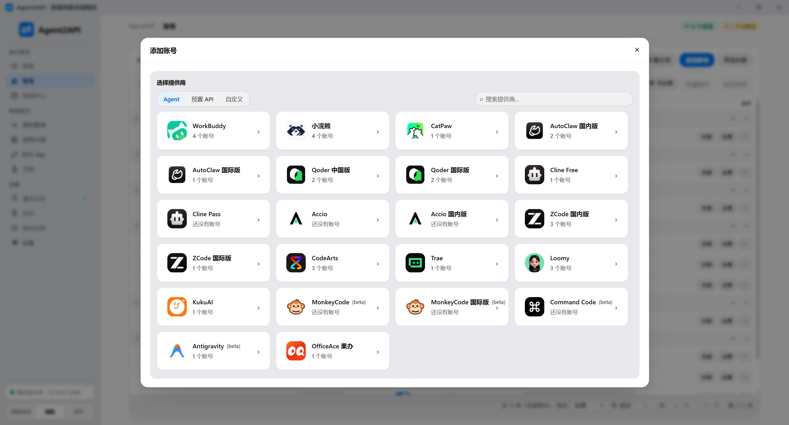
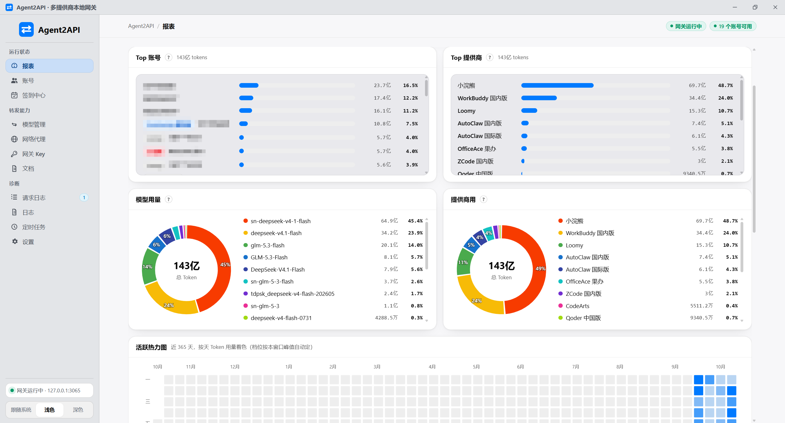

<div align="center">

# Agent2API

**複数の AI デスクトップクライアントのログイン状態を、ローカルの OpenAI 互換 API ゲートウェイに**

[简体中文](./README.md) | [English](./README.en.md) | [繁體中文](./README.zh-Hant.md) | **日本語** | [한국어](./README.ko.md) | [Português (BR)](./README.pt-BR.md)

[](./LICENSE)
[](https://github.com/aimod-cc/agent2api/releases/latest)
[](https://hub.docker.com/r/aimodcc/agent2api)
[](https://github.com/aimod-cc/agent2api/stargazers)
[](https://github.com/aimod-cc/agent2api/releases/latest)

[✨ 主な機能](#-主な機能) • [🤝 対応プロバイダー](#-対応プロバイダー) • [🚀 クイックスタート](#-クイックスタート) • [🐳 Docker デプロイ](#-docker-デプロイ) • [📸 画面プレビュー](#-画面プレビュー) • [🔧 開発とビルド](#-開発とビルド) • [📜 使用に関する告知](#-使用に関する告知)

</div>

---

単一の `base_url` を公開し、マルチプロバイダーのアカウント管理、モデル管理、外向きプロキシ、リクエストレポートを備え、すぐに使える Tauri デスクトップアプリも同梱しています。カスタム `base_url` に対応した OpenAI クライアントならどれでも、`http://127.0.0.1:3065/v1` からこれら各社のモデル枠を呼び出せます —— **上流の API キーは不要、クライアントの変更も不要**です。

## ✨ 主な機能

- 🔌 **OpenAI 互換エンドポイント** —— `/v1/chat/completions`、`/v1/responses`、`/v1/messages`（`count_tokens` を含む）と `/v1/models` を 1 つのゲートウェイで公開。どのクライアントでもそのまま接続できます
- 🏪 **内蔵 17 社のプロバイダー** —— WorkBuddy、小浣熊、CatPaw、AutoClaw、Qoder、Cline、Accio、ZCode、CodeArts、Trae、Loomy、KukuAI、MonkeyCode、Command Code、Antigravity、OfficeAce（一部は中国版 / 国際版の 2 種類）に加え、カスタムのパススループロバイダー（Chat / Responses / Anthropic）にも対応
- 🔁 **認証情報の全自動メンテナンス** —— トークン自動更新（シングルフライト重複排除）、期限が近い認証情報の一括更新、モデルカタログのリモート更新 + 静的フォールバック
- 🪂 **安定した転送** —— グローバル優先度アカウントキュー、モデル別レート制限クールダウン、429 自動フォールバック、決定論的な失敗は空待ちせず即スキップ
- 🛡️ **セキュリティと秘匿化** —— 外向きプロキシ、送信フィンガープリントの秘匿化、複数のゲートウェイキー、fail-closed、ログイン時の人間確認
- 📊 **リクエストレポート** —— リクエスト数 / 成功率 / トークン量、24 時間のキャッシュヒット率と消費トレンド、トップモデルとアカウント、365 日のアクティビティヒートマップ
- ⏰ **スケジュールタスク** —— 自動チェックイン、認証情報メンテナンス、モデルカタログ更新などのバックグラウンドタスクを、有効 / 無効・間隔・前回結果を 1 ページで管理
- 💰 **残高がひと目でわかる** —— アカウント行内の残高 / 使用量表示、アカウント横断の並行照会と定期スナップショット
- 🖥️ **2 つのデプロイ形態** —— Tauri デスクトップアプリ（トレイ常駐、Node ランタイム不要）/ Docker headless（パネル + ゲートウェイを同一ポートで）。パネル UI は 6 言語対応

## 🤝 対応プロバイダー

各プラットフォームのリバースプロキシ対応状況（✓ 対応 · ✗ 非対応 · — 該当なし）:

| プラットフォーム | LLM リクエスト | トークン自動更新 | モデル一覧 | 残高照会 | チェックイン | 受け取り系 |
| --- | :--: | :--: | :--: | :--: | :--: | :--: |
| WorkBuddy 中国版 | ✓ | ✓ | ✓ リモート + 静的フォールバック | ✓ | ✓ デイリーチェックイン | — |
| WorkBuddy 国際版 | ✓ | ✓ | ✓ リモート + 静的フォールバック | ✓ | ✗ チェックインなし | — |
| 小浣熊 | ✓ | ✓ | ✓ リモート + 静的フォールバック | ✓ | ✓ デスクトップログインのポイント | — |
| CatPaw | ✓ | ✗ 更新の仕組みなし | ✓ リモート + 静的フォールバック | ✓ | ✗ | — |
| AutoClaw（中国版 / 国際版） | ✓ | ✓ | ✓ リモート + 静的フォールバック | ✓ | ✓ デイリーチェックイン | — |
| Qoder | ✓ | ✓ | ✓ リモート（地域別）+ 静的フォールバック | ✓ | ✓ 中国版のみ | — |
| Cline（Free / Pass） | ✓ | ✓ | ✓ リモート + 静的フォールバック | ✓ | — | — |
| Accio（国際版 / 中国版） | ✓ | ✓ | ✓ リモート + 静的フォールバック | ✓ 使用率のみ | — | — |
| ZCode（中国版 / 国際版） | ✓ | ✗ | ✗ 静的テーブル | ✓ プラン残高 | — | ✓ 期間限定プラン（手動） |
| CodeArts | ✓ | ✓ ワンショットローテーション | ✓ リモート（3 ソース統合） | ✓ 2 つの台帳 | — | ✓ デイリーボーナス（手動） |
| Trae | ✓ | ✓ 1 回ごとに更新 | ✓ リモートのみ | ✓ 2 つの台帳 | — | — |
| Loomy（iFlytek） | ✓ | ✗ 更新 API なし | ✓ リモートのみ | ✓ 2 つのポイント台帳 | ✓ デイリー付与ポイントの更新 | — |
| KukuAI（Baidu Wenku） | ✓ | ✗ 更新 API なし | ✓ リモート + 静的フォールバック | ✓ ポイント残高 | ✓ デイリーチェックイン（無料ポイント） | — |
| MonkeyCode（長亭科技、中国版 / 国際版） | ✓ | ✗ 更新 API なし | ✓ リモートのみ | — | — | — |
| Command Code | ✓ | ✗ 静的な API キー | ✓ リモート + 静的フォールバック | — | — | — |
| Antigravity（Google、Gemini） | ✓ | ✓ | ✓ リモート + 静的フォールバック | — | — | — |
| OfficeAce（Huawei Cloud、OfficeClaw） | ✓ | ✓ コントロールプレーンの自動更新 | ✓ リモートのみ | ✓ ポイント残高 | ✓ デイリーボーナス（チェックイン + 新規特典） | — |
| カスタムプロバイダー | ✓ Chat パススルー / Responses / Anthropic | — | ✓ 手動登録 + サーバー側取得 | — | — | — |

`/v1/chat/completions`、`/v1/responses`、`/v1/messages`（`count_tokens` を含む）と `/v1/models` はすべてのプラットフォームで同じように扱われます。モデルマッピング、グローバル優先度キュー、429 フォールバック、外向きプロキシ、送信フィンガープリントの秘匿化、リクエストレポートも全プラットフォーム共通です。

> **本プロジェクトは学習・交流目的のみです。** 非公式クライアントの形態で自分のアカウントのログイン状態を再利用するため、上流サービスの規約に適合しない可能性があります。リスク（アカウントの凍結などを含む）は利用者自身が負担し、商用利用・課金の回避は禁止です。詳しくは[使用に関する告知](#-使用に関する告知)と [LICENSE](./LICENSE) をご覧ください。
>
> 本プロジェクトは個人用途のローカルプロキシツールであり、各上流ベンダーおよびその公式製品とは一切関係ありません（一覧は[使用に関する告知](#-使用に関する告知)）。インターフェース仕様は各社クライアントの通信の観察によるもので、上流はいつでも変更される可能性があります。

## 🚀 クイックスタート

[Releases](https://github.com/aimod-cc/agent2api/releases/latest) からインストーラー（NSIS、簡体字中国語、既定では `C:\Program Files\Agent2API` にインストール、セットアップ時に管理者権限が必要）をダウンロードし、インストール後そのまま起動してください。**Node やその他のランタイムは不要です。**

1. 初回起動時に、アプリのプロセス内で本機ゲートウェイ（ポート 3065）が起動し、メインウィンドウが開きます。旧バージョンのデータディレクトリやデータファイルが見つかった場合は、移行を促すダイアログが表示されるので、案内に従って操作してください。
2. 「アカウント」ページの「アカウントを追加」をクリックし、プロバイダーを選んでダイアログの案内どおりにログインまたは認証情報を入力します（Web ログイン / SMS 認証コード / 認証情報の貼り付け / 本機のログイン状態の取り込み）。
3. OpenAI クライアントの `base_url` に `http://127.0.0.1:3065/v1` を設定し、`api_key` は何でも構いません（例: `sk-local`。認証を有効にしていない場合、サーバー側は検証しません）。

ウィンドウを閉じても既定ではトレイに最小化されるだけで、ゲートウェイはバックグラウンドで転送を続けます。完全に終了するには、トレイアイコンを右クリックして「終了」を選んでください。

### 動作確認

ゲートウェイが起動したら、curl で接続を確認します（`model` には `GET /v1/models` に実在する名前を入れてください）:

```bash
curl http://127.0.0.1:3065/health
curl http://127.0.0.1:3065/v1/models

curl http://127.0.0.1:3065/v1/chat/completions \
  -H 'Content-Type: application/json' \
  -d '{"model":"deepseek-v4.1-flash","messages":[{"role":"user","content":"你好"}],"stream":true}'
```

クライアントからの呼び出し例（Python SDK）:

```python
from openai import OpenAI

client = OpenAI(base_url="http://127.0.0.1:3065/v1", api_key="sk-local")
resp = client.chat.completions.create(
    model="deepseek-v4.1-flash",     # 一覧にあるどのプロバイダーのものでも可 — GET /v1/models を参照
    messages=[{"role": "user", "content": "你好"}],
)
print(resp.choices[0].message.content)
```

**ブラウザー上のページ**（自作の Web UI など）から `fetch` で直結するとクロスオリジンのプリフライトで拒否されます —— ゲートウェイは既定で CORS に応答せず、プリフライトは API キー検証に到達して 401 になります。解決策: ① 設定ページの「セキュリティ → ゲートウェイのクロスオリジンアクセス」を有効に（オリジン `*`。任意の Web ページから本機ゲートウェイを叩けてしまうため「ゲートウェイキー」も併せて設定してください）; ② ページをゲートウェイと同一オリジンに —— ローカルの静的サーバーでページを配信し `/v1` を `127.0.0.1:3065` にリバースプロキシします。

### LAN アクセス

既定では `127.0.0.1` のみをリッスンします。「設定 → 一般 → LAN アクセス」を有効にするとすべてのネットワークアダプターで待ち受け、LAN 内の機器は API アドレスを本機の IP に向けるだけで（画面に完全なアドレスが表示されます）アカウント群を共有できます。セキュリティのため、有効化の前にパネル管理者の登録が必要です。管理 API は管理者セッションまたはゲートウェイキーを要求し、有効なキーが無い場合は転送 API も拒否します（有効化の流れで「既定」キーが自動追加されます）。Web パネルの LAN 公開も任意で選べます（既定は非公開）。変更は再起動後に有効です。

## 🐳 Docker デプロイ

```bash
docker run -d --name agent2api --restart unless-stopped \
  -p 3065:3065 -v ./data:/data \
  aimodcc/agent2api:latest
```

ブラウザーで `http://<ホスト>:3065` を開くと、初回は**管理者アカウントの登録**へ案内されます。ログイン後、「ゲートウェイキー」ページでクライアント用の API キーを作成してください —— `http://<ホスト>:3065/v1` が OpenAI 互換エンドポイントです（キーを作成するまで転送は拒否されます）。すべての状態（SQLite データベース / 設定 / ログ）は `./data` ボリューム 1 つに収まります。

compose を使う場合（amd64 / arm64 のイメージがあります）:

```yaml
services:
  agent2api:
    image: aimodcc/agent2api:latest
    container_name: agent2api
    restart: unless-stopped
    ports:
      - "3065:3065"
    volumes:
      - ./data:/data
```

環境変数（すべて任意）:

| 変数 | 説明 |
| --- | --- |
| `AGENT2API_ADMIN_USER` + `AGENT2API_ADMIN_PASSWORD` | 管理者アカウントとパスワードを事前設定（パスワードは平文で指定、起動時に自動でハッシュ化）。未設定ならパネルで登録 |
| `AGENT2API_PANEL_PORT` | パネルを別ポートに分離: 設定するとパネル（UI + `/api/*`）がそのポートだけで待ち受け、公開側はメインポートのみをマッピングして管理面を内部に留められます（パネルポートはループバックに束縛。`127.0.0.1:3066:3066` のように記述） |
| `AGENT2API_HOST` / `AGENT2API_PROXY_PORT` | リッスンアドレス（既定 `0.0.0.0`）/ ポート（既定 `3065`） |
| `AGENT2API_ALLOW_NO_KEY` | `1` で fail-closed を無効化（キー未設定でも `/v1` を許可。純粋な内部ネットワーク限定） |
| `AGENT2API_CAPTCHA_ENABLED` | ログインページの人間確認ウィジェット: 既定 `1`（有効）、`0` で無効 |
| `AGENT2API_SELF_UPDATE` | コンテナ内の更新入口: 既定 `1`（有効。パネルから「ダウンロードして更新」可能）。`0` で無効化し手動更新のみに |
| `WORKBUDDY_UPDATE_REPO` + `WORKBUDDY_UPDATE_API_BASE` | 上級: 「更新確認 / 更新ダウンロード」を自前のソースに差し替えます。前者はリポジトリを変更（既定は上流の `aimod-cc/agent2api`。fork 後は変更可）、後者は API ルートを変更（既定 `https://api.github.com`。GitHub と同じ形の release JSON を返す必要があります）。自前ソース設定後、ダウンロードの許可リストは**そのソース自身のホスト**のみを追加で許可します（スキームはソースに従う: `http://` を設定すれば平文ダウンロードも許可。ローカル演習 / 内部ミラー向け） |

ソースからビルドする場合: 本リポジトリをクローンして `docker compose up -d --build`（イメージにはゲートウェイとパネルのみが入り、Rust ツールチェーンは含まれません）。

<details>
<summary><b>更新とロールバック</b>（クリックで展開）</summary>

**パネルから直接更新**: 設定 → ソフトウェア更新 → 更新を確認し、新しいバージョンが見つかったら「ダウンロードして更新」を、パッケージのダウンロード後は「インストールして再起動」をクリックします。サーバーは sha256 を検証し、コンテナ内の実行ファイルと UI ファイルを置き換えてからプロセスを再起動します —— コンテナは `restart: unless-stopped` によって再び立ち上がり（同じコンテナ、データボリュームはそのまま）、ページは数秒後に自動で再読み込みされます。前のバージョンに戻したいときは、同じパネルの「前のバージョンへロールバック」を使ってください（更新時に残されたバックアップから復元します）。

知っておくべき 3 点:

- **更新されるのはコンテナ内のファイルで、ローカルのイメージではありません**: compose の `image:` タグは変わらず、`docker inspect` は古いタグを表示したままです。後から `docker compose pull && docker compose up -d`（コンテナ再作成）を実行するとイメージのバージョンに戻ります。両者を揃えたい場合は、更新後に compose のタグを新しいバージョン番号に書き換えてから `docker compose pull && up -d` をもう一度実行してください。
- 更新入口はコンテナ内でのみ現れます（`AGENT2API_SELF_UPDATE=1`。イメージでは既定で設定済み）。`0` にすれば下記の手動方法に戻ります。
- パッケージは GitHub Release から取得します（`agent2api-server-linux-<arch>.tar.gz` + 同名の `.sha256`）。ダウンロードは「更新設定」で設定した外向き経路（更新確認と共通）を使います。国内からの直接接続が不安定な場合は、そこでプロキシを指定するか GitHub トークンを設定してください。

**手動更新**（どのデプロイ形態でも使えます）:

```bash
# compose（本リポジトリの compose を使っている場合）
docker compose pull && docker compose up -d

# docker run: 新しいイメージを取得してコンテナを作り直す（データは ./data ボリュームにあり失われません）
docker pull aimodcc/agent2api:latest
docker rm -f agent2api
# 上の「docker run」のコマンドをもう一度実行
```

ソースからビルドしている場合: `git pull && docker compose up -d --build`。

</details>

**Web パネルでの機能差**（「本機デスクトップクライアントが無い」ことに起因）: Web ログイン（WorkBuddy / Qoder / Cline）、SMS 認証コード、認証情報の貼り付けは完全に利用できます。本機へのコールバックが必要な Web ログイン（AutoClaw / CatPaw / Accio / CodeArts / Trae）と「本機ログイン状態の取り込み」は利用できないため、認証情報の貼り付けをお使いください。

## 📸 画面プレビュー

### アカウント

すべてのアカウントが 1 本のキューに並び（左から 2 列目が優先度）、1 件ずつ有効化 / 無効化できます。レート制限のクールダウン、有効期限、残高は行内に表示され、残高不足は既定でしきい値を下回るとスキップされます。


アカウント追加はプロバイダーを選んでログインするだけ。同じプロバイダーで複数バージョンのアカウントを保持できます（例: WorkBuddy 中国版 / 国際版）:



### レポート

概要: リクエスト数 / 成功率 / トークン量 / トップモデルとアカウント・プロバイダー別ランキング、用量ドーナツと 365 日のアクティビティヒートマップ:



トレンド: 24 時間の**キャッシュヒット率**（折れ線）と**トークン消費**（面）を二軸で重ね、下部に日別トークン棒グラフ:


### スケジュールタスク

バックグラウンドタスクはこのページに集約（有効 / 無効・間隔 / 前回結果 / 今すぐ実行）。一覧は `~/.agent2api/config.json` の `scheduledTasks` に保存され、変更は即時反映されます。


## 🧱 プロジェクト構成

バックエンドは `src-tauri/` 配下の Rust 製インプロセス HTTP サーバー、フロントエンドは `ui/` 配下の素の HTML/CSS/JS です。

<details>
<summary>ディレクトリツリー全体（クリックで展開）</summary>

```
agent2api/
├─ desktop-tauri/
│  ├─ src-tauri/
│  │  ├─ server/                 ゲートウェイ本体 crate（agent2api-server、単独でビルド可能:
│  │  │                          デスクトップ版と headless バイナリで共用。src/server/ の
│  │  │                          実装と bin/agent2api-server.rs に GUI 依存はない）
│  │  │  ├─ mod.rs               サービス組み立て: ServerState、起動、停止、起動時移行
│  │  │  ├─ http.rs              ルートテーブル、CORS、API キーミドルウェア、body 制限、headless 静的配信
│  │  │  ├─ config.rs / logging.rs / logs_store.rs / errors.rs
│  │  │  ├─ config_migration.rs  1.x 設定ディレクトリの移行（~/.workbuddy-proxy → ~/.agent2api、起動時の最初のステップ）
│  │  │  ├─ request_stats.rs + request_stats/   統計の時間窓、書き込み、集計、トリミング
│  │  │  ├─ core/
│  │  │  │  ├─ providers/        ★ マルチプロバイダー層（本改造の核心）
│  │  │  │  │  ├─ mod.rs        ProviderKind（内蔵各社。Cline はクォータプールで 2 つ、Accio と
│  │  │  │  │  │                ZCode は地域で 2 つに分割）+ PROVIDERS レジストリ + id 相互参照
│  │  │  │  │  ├─ adapter.rs    ProviderAdapter trait + adapter_for + implemented_kinds
│  │  │  │  │  ├─ router.rs     モデル名 → 候補プロバイダー集合（集約カタログ）
│  │  │  │  │  ├─ catalog.rs    集約モデルカタログ（一覧のマージ / 同名の重複排除 / 可用性判定）
│  │  │  │  │  ├─ catalog_cache.rs  各社リモート一覧の永続キャッシュ（再起動後は読み戻し、内蔵一覧へは戻らない）
│  │  │  │  │  ├─ refresh_flight.rs  認証情報更新のシングルフライト重複排除
│  │  │  │  │  ├─ workbuddy.rs  WorkBuddy アダプター（ヘッダー集合 / system 注入 / 6004 / 11-128）
│  │  │  │  │  ├─ raccoon/      小浣熊: mod / models / credentials / jwt / oauth / balance
│  │  │  │  │  ├─ catpaw/       CatPaw: adapter（is_stateful）/ conversation（ターン状態機械）/
│  │  │  │  │  │                turn_executor / prepare / decision（ターン判定）/ fingerprint /
│  │  │  │  │  │                registry/（セッションレジストリ: テーブルとハンドル / アカウント同一性 / 失効）/
│  │  │  │  │  │                messages / blocks / tools / openai（翻訳層）/
│  │  │  │  │  │                upstream_http / image_compress / models / credentials / balance
│  │  │  │  │  ├─ autoclaw/     Zhipu autoglm（中国版 + 国際版の 2 社）: region（両地域のドメインと同一性）/
│  │  │  │  │  │                adapter / credentials / refresh / crypto / models /
│  │  │  │  │  │                balance / login（SMS 認証コード、中国版のみ）/
│  │  │  │  │  │                oauth（Zai / Google の Web ログイン、国際版のみ）/ checkin（デイリーチェックインタスク）
│  │  │  │  │  ├─ qoder/        Qoder: adapter / endpoints（両サイトのアドレス）/ oauth（デバイス認証）/
│  │  │  │  │  │                auth / cosy（COSY 署名と body エンコード）/ protocol（エンベロープ復号）/
│  │  │  │  │  │                chat（セッション方式の転送）/ stream / machine（PKCE とマシン識別）/
│  │  │  │  │  │                credentials / refresh / models / balance / risk（UMID リスク管理コンポーネント）
│  │  │  │  │  ├─ cline/        Cline: adapter（Bearer + プロダクト面ヘッダー）/ credentials（workos: 接頭辞
│  │  │  │  │  │                + デスクトップログイン状態 + 氏名解析）/ login（WorkOS デバイス認証）/
│  │  │  │  │  │                refresh（シングルフライト更新）/ models（2 つのクォータプール + 既定マッピング種）/
│  │  │  │  │  │                balance（credit 残高、マイクロ credit ÷1e6）
│  │  │  │  │  ├─ accio/        Accio（国際版 + 中国版の 2 社）: endpoints（両地域とエンドポイント）/
│  │  │  │  │  │                credentials / auth / refresh（シングルフライト更新）/
│  │  │  │  │  │                oauth（PKCE Web ログイン + ループバックコールバック）/
│  │  │  │  │  │                models（静的フォールバック + /api/llm/config/v2）/
│  │  │  │  │  │                protocol（OpenAI ↔ ADK の Gemini 風エンベロープ）/
│  │  │  │  │  │                chat（セッション方式の転送）/ stream（ADK SSE 展開）/ balance
│  │  │  │  │  ├─ zcode/        ZCode（Zhipu Z.AI、中国版 + 国際版の 2 社）: region（両地域のドメインと同一性）/
│  │  │  │  │  │                adapter（ステートレス、地域でパラメータ化）/ credentials（トークン + プラン JWT）/
│  │  │  │  │  │                oauth（CLI ポーリングログイン）/ coding_key（推論用 API キーへの交換）/ models（静的テーブル）/
│  │  │  │  │  │                balance（プラン残高）/ plan + claim（プランチャネルと期間限定受け取り）/
│  │  │  │  │  │                captcha（人間確認トークンプール）/ reasoning（GLM-5.3 思考予算）/
│  │  │  │  │  │                zcode_system.json（システムプロンプト）
│  │  │  │  │  ├─ codearts/     CodeArts（Huawei Cloud）: signer（Huawei Cloud SDK-HMAC-SHA256、
│  │  │  │  │  │                参照実装とバイト単位で突き合わせ）/ credentials / dpop（ES256 DPoP proof）/
│  │  │  │  │  │                oauth（PKCE Web ログイン + ループバックコールバック）/ refresh（シングルフライト更新）/
│  │  │  │  │  │                session（chat-session ハートビートとアカウント単位の並行入場制御）/ chat（セッション方式の転送）/
│  │  │  │  │  │                stream_fault（HTTP 200 内のストリームエラーエンベロープ）/ redact（エラー本文の秘匿化）/
│  │  │  │  │  │                models（agent / builtin / 福利ゲートウェイの 3 ソース統合）/
│  │  │  │  │  │                balance（サブスクリプション統計 + 福利ゲートウェイの 2 台帳）/
│  │  │  │  │  │                welfare（デイリーボーナスの受け取り: 冪等キーを先に永続化し、読み戻しで二重確認）
│  │  │  │  │  ├─ trae/         Trae（ByteDance AI IDE の SOLO チャネル）: credentials / device（デバイス鍵ペア）/
│  │  │  │  │  │                login + oauth（PKCE Web ログイン + トークン交換候補）/ callback_server
│  │  │  │  │  │                （本機のランダムポートでのコールバックとノイズ除去）/ refresh（シングルフライト更新）/
│  │  │  │  │  │                payload（SOLO エンベロープをホワイトリストで再構築）/ headers（SOLO ヘッダー集合）/
│  │  │  │  │  │                stream（SSE→chunk 翻訳）/ forward（ステートフル転送）/
│  │  │  │  │  │                errors（エラー分類と死んだ設定のリスト）/ models（get_detail_param カタログ）/
│  │  │  │  │  │                usage（特典パック + プランクォータの 2 台帳）/ profile（同一性解析）
│  │  │  │  │  ├─ loomy/        Loomy（iFlytek）: login（SMS 認証コード）/ credentials（session 14 日、更新 API なし）/
│  │  │  │  │  │                sign（クライアントの HMAC-SHA1 署名ヘッダーを再現）/ endpoints / client（統合ゲートウェイ）/
│  │  │  │  │  │                models（/api/v1/models のリモートカタログのみ、上流に内蔵フォールバック一覧なし）/
│  │  │  │  │  │                balance（永久ポイント + デイリー付与の 2 台帳）/ checkin（その日の初回ログインで付与ポイントを更新）
│  │  │  │  │  ├─ kuku/         KukuAI（Baidu Wenku「Kuku AI / GenFlowPro」、kuku.baidu.com）:
│  │  │  │  │  │                adapter（is_stateful）/ session（bdstoken/uinfo/uk の 3 点セットキャッシュ）/
│  │  │  │  │  │                engine（STOKEN 交換）/ http / login（本体サイトの Web ログイン + シェル側での Cookie 取得）/
│  │  │  │  │  │                credentials（BDUSS Cookie）/ models（静的フォールバック + リモート更新）/
│  │  │  │  │  │                chat（セッション作成 → 計算資源割当 → SSE）/ balance（ポイント残高）/
│  │  │  │  │  │                checkin（デイリー無料ポイント）
│  │  │  │  │  ├─ monkeycode/   MonkeyCode（長亭科技、中国版 + 国際版の 2 社）: region（両サイトのドメインと同一性）/
│  │  │  │  │  │                adapter / endpoints（パス / cookie 名 / interface_type→CLI 対応）/
│  │  │  │  │  │                client / credentials（session + imageId）/ login（session の貼り付けと自動検出）/
│  │  │  │  │  │                models（両サイト各 1 枠の一覧、リモートのみ）/ task（タスク作成）/ stream（WS タスクストリーム）/
│  │  │  │  │  │                translate（ACP イベント → chat フレーム。ツールの自動承認と質問への自動応答を含む）
│  │  │  │  │  ├─ commandcode/  Command Code: adapter / endpoints / credentials / login /
│  │  │  │  │  │                fingerprint（決定論的デバイスフィンガープリントと 8h レポート）/ models /
│  │  │  │  │  │                plan（8 キーのエンベロープと params 書き換え、session id の派生）
│  │  │  │  │  ├─ antigravity/  Antigravity（Google、Gemini）: oauth（refresh token 更新 + シングルフライト）/
│  │  │  │  │  │                project（loadCodeAssist → onboardUser の検出）/ credentials /
│  │  │  │  │  │                endpoints（3 環境のベース URL とヘッダー集合）/ login /
│  │  │  │  │  │                models（fetchAvailableModels + 内蔵フォールバック + 上流の実名マッピング）/ adapter
│  │  │  │  │  └─ officeace/    OfficeAce（Huawei Cloud、OfficeClaw）: oauth（PKCE + P-256 DPoP セルフサービスログイン）/
│  │  │  │  │                   signer（SDK-HMAC と V11-HMAC の 2 種類の署名 + ベクター fixtures）/
│  │  │  │  │                   credentials（ゲートウェイ Basic + コントロールプレーンの一時 AK/SK）/
│  │  │  │  │                   chat（ステートレスな OpenAI 互換）/ models（リモート目録 + モデル別倍率）/
│  │  │  │  │                   probe（可用性プローブ。疎通できないモデルは既定で非表示）/
│  │  │  │  │                   subscription（サブスクリプション / クォータ / 報酬）/ onboarding / checkin / balance
│  │  │  │  ├─ protocol/        プロトコル変換層（各社 wire ↔ 標準 chat SSE のリクエスト / レスポンス翻訳:
│  │  │  │  │                    Anthropic Messages / Responses / NDJSON（Command Code）/
│  │  │  │  │                    Gemini エンベロープ（Antigravity）、およびツール plan と履歴修復）
│  │  │  │  ├─ upstream/        転送オーケストレーション: グローバルアカウントキューのループ（provider_loop）+
│  │  │  │  │                    送信 body の処理（payload）+ SSE パススルー / 集約 + usage のバイパス抽出 +
│  │  │  │  │                    chat 以外のプロトコルの翻訳ストリーム接続（translate: Anthropic / NDJSON / Gemini の 3 系統）
│  │  │  │  ├─ account_store/   アカウント保存（グローバル優先度、レート制限クールダウン、各社の追加と取り込み）
│  │  │  │  ├─ models/          モデルカタログの基盤（workbuddy 内蔵一覧 + /v3/config 更新）
│  │  │  │  ├─ model_rules.rs   モデル管理ルール（無効化 / 非表示 / マッピング alias）
│  │  │  │  ├─ api_keys.rs      ゲートウェイキー一覧（複数キー、有効なものが 1 つあれば通過）
│  │  │  │  ├─ auth.rs / auth_http.rs / login.rs   セッション、外向き転送、ヘッドレスログイン
│  │  │  │  │                    （login/ 配下は各社固有のフロー: catpaw の
│  │  │  │  │                    ループバックコールバック、qoder のデバイス認証）
│  │  │  │  ├─ routing.rs / billing/   アカウント経路選択（グローバル優先度 + レート制限クールダウン）/ ポイントチェックイン運用
│  │  │  │  ├─ proxies.rs / clash.rs / egress.rs   外向きプロキシと出口ごとのキャッシュ済み Client
│  │  │  │  ├─ sanitize.rs      送信フィンガープリントの秘匿化（ハードコードされたルール集: ヘッダー除去 + 定型文の最小書き換え）
│  │  │  │  ├─ prompt.rs        ゲートウェイ独自のシステムプロンプト（パススルー / 置換 / 追記の 3 モード）
│  │  │  │  ├─ degrade.rs       コンテンツ遮断の劣化状態機械（審査の誤検知に当たったら翌日 00:00 まで中立プロンプト）
│  │  │  │  ├─ credential_maintenance.rs  期限切れ / 期限間近の認証情報の一括更新
│  │  │  │  ├─ usage_query.rs     残高 / ポイント照会（アカウント横断の並行実行 + 定期実行時のスナップショット）
│  │  │  │  ├─ scheduled_tasks.rs  間隔ベースのスケジュールタスク登録簿とディスパッチループ（有効 / 無効 / 間隔 /
│  │  │  │  │                      前回結果。設定は config.json の scheduledTasks）
│  │  │  │  └─ account_transfer.rs + account_transfer/ / auto_checkin.rs / update/
│  │  │  │                       インポート / エクスポート（同一性の正規化を含む）/ 定時チェックイン / ソフトウェア更新
│  │  │  └─ api/                 各ルートのハンドラー（health/session/accounts/accounts_usage/
│  │  │                          chat/models/keys/model_manage/stats/logs/billing/
│  │  │                          sanitize/prompt/auto-checkin/scheduled-tasks/update/…）
│  │  ├─ lib.rs                 アプリのエントリーポイント（設定ディレクトリ移行 → 設定 → トレイ → メインウィンドウ → バックエンド起動）
│  │  ├─ backend.rs              インプロセスサーバーのライフサイクル
│  │  ├─ legacy_install.rs       旧「現在のユーザー」インストールのクリーンアップ（ディレクトリ / ショートカット / アンインストール項目 / 自動起動。release のみ）
│  │  ├─ gateway.rs              シェル側から管理 API を叩く HTTP クライアント
│  │  ├─ login.rs / commands.rs  ログインウィンドウとポーリング、フロントエンドに公開する invoke コマンド
│  │  ├─ login_profile.rs        Web ログインごとに専用の一時 WebView2 データディレクトリ（完了後に削除）
│  │  ├─ bridge.rs               window.workbuddyDesktop を注入するブリッジスクリプト
│  │  └─ update.rs / settings.rs / state.rs / tray.rs
│  ├─ ui/                        フロントエンド（素の HTML/CSS/JS、フレームワークなし）
│  ├─ i18n/                      UI 辞書のソースとビルドスクリプト（6 言語）
│  └─ src-tauri/tauri.conf.json  パッケージ設定（NSIS）
├─ build/make-icon.mjs           アプリアイコンのソース画像を生成
├─ assets/screenshots/           README 用の画像（UI スクリーンショット）
├─ Dockerfile / .dockerignore    headless イメージ（マルチステージビルド、ゲートウェイとパネルのみ）
├─ docker-compose.yml / .env.example   デプロイ（単一コンテナ: パネル + ゲートウェイを同一ポートで）
└─ package.json                  ビルドスクリプトの入口（tauri:dev / tauri:build / build:icon）
```

</details>

## 🔧 開発とビルド

### 動作環境

- Rust >= 1.77 と Tauri 2 ツールチェーン（デスクトップアプリ本体のコンパイル用。Windows では WebView2 ランタイムも必要）
- Node.js >= 18.17（`npm run tauri:*` とフロントエンドのビルドスクリプトの実行のみ。デスクトップアプリは実行時に Node へ依存しません）

### よく使うスクリプト

```bash
npm run tauri:install      # デスクトップの依存関係をインストール（npm --prefix desktop-tauri install と同等）
npm run tauri:dev          # 開発モードでデスクトップアプリを起動（ホットリロード付き）
npm run tauri:build        # デスクトップのインストーラーをビルド

npm run build:icon         # アイコンのソース画像を生成（アイコン設計を変えた後に実行し、続けて tauri icon を実行）
```

パッケージ成果物は `target/release/bundle/nsis/Agent2API_<バージョン>_x64-setup.exe`（現在およそ 3.0 MB。`src-tauri/.cargo/config.toml` が cargo の `target-dir` をプロジェクトルートの `target/` に指定しています）。

## 📜 使用に関する告知

### 学習・交流目的に限る

本プロジェクトは、HTTP リバースプロキシ、SSE ストリーミングのパススルー、複数アップストリームのプロトコル適応、デスクトップパッケージング（Tauri）といった技術テーマを学ぶための実践プロジェクトであり、**個人の学習・研究目的のみ**を対象としています。公式製品ではなく、Tencent および WorkBuddy / CodeBuddy、Meituan および CatPaw、SenseTime および小浣熊、Zhipu および AutoClaw / autoglm、Alibaba および Qoder / Accio、Huawei Cloud および CodeArts / OfficeAce、ByteDance および Trae、iFlytek および Loomy、Baidu Wenku および KukuAI、長亭科技 および MonkeyCode、Command Code、Google および Antigravity のいずれとも一切の関係がなく、その承認やスポンサーシップも受けていません。

### リバースプロキシの挙動について

本プロジェクトが実装しているのはローカルのリバースプロキシです。自分のマシン上で自分のアカウントのログイン状態を再利用し、リクエストを公式の上流ゲートウェイへ転送します。有料機能や権限チェックを突破・回避するものではなく、使用するクォータは常に自分のアカウントが元々持つ枠から来ます。ただし明確にしておくべきは、この「非公式クライアントの形態でログイン状態を再利用する」転送方法が、**上流サービスの利用規約や利用条件に適合しない可能性がある**という点です。利用するかどうか、およびそれに伴う一切の結果（レート制限、リスク管理の対象化、アカウントの停止や凍結を含みますがこれらに限りません）は、すべて利用者自身が負担します。

### 禁止事項

本プロジェクトを、いかなる商用目的、利益目的の再配布、大量アカウント運用、上流の課金やクォータ制限の回避、その他現地の法令に違反する活動に使用することを禁じます。関連するモデルサービスを本番環境や商用シーンで呼び出す場合は、公式チャネルと公式 API をご利用ください。

### 認証情報とデータのリスク

本プロジェクトはアカウントの認証情報（`accessToken` / `refreshToken` など）を**平文**で本機の設定ディレクトリ（既定は `~/.agent2api/`）に保存し、エクスポート機能が生成するファイルにも平文の認証情報が含まれます。適切に管理し、公開リポジトリへのコミット、クラウドストレージへのアップロード、第三者への共有は絶対に行わないでください。認証情報の漏えいによる損害は利用者自身が負担します。

### 無保証および権利表示

本プロジェクトは「現状のまま」提供され、作者はその可用性、安定性、安全性、特定目的への適合性について一切保証しません。上流のインターフェースはいつでも変更される可能性があり、本プロジェクトは予告なく動作しなくなり、メンテナンスが終了する場合があります。完全な条件は [LICENSE](./LICENSE) を参照してください。本プロジェクトにおけるインターフェース仕様やプロトコルフィールドなどの情報は、各公式クライアントの公開されたネットワーク通信を観察・整理したものであり、関連する商標とサービスの権利はそれぞれの所有者に帰属します。権利者が必要以上のものであるとお考えの場合は作者までご連絡ください。速やかに調整または削除します。

## 📄 ライセンス

本プロジェクトは [MIT License](./LICENSE) に基づき公開されており、著作権表示を保持する限り、自由に使用・改変・配布できます。

注意すべき点として、LICENSE の本文の後に**使用に関する告知**が付されており、その第 3 条が MIT に対して**制限を追加**しています（商用利用の禁止、利益目的の再配布の禁止、大量アカウント運用の禁止）。したがって本プロジェクトは**純粋な MIT ではありません** —— **MIT の条件と使用に関する告知が合わせて完全なライセンスと使用条件を構成し**、同一の行為について両者が異なる結論を出す場合は、より厳しい側が優先されます。これが `Cargo.toml` で SPDX の `"MIT"` を宣言せず、`license-file` で LICENSE を指している理由でもあります。

## ⭐ Star History

<a href="https://star-history.com/#aimod-cc/agent2api&Date">
  <picture>
    <source media="(prefers-color-scheme: dark)" srcset="https://api.star-history.com/svg?repos=aimod-cc/agent2api&type=Date&theme=dark" />
    <source media="(prefers-color-scheme: light)" srcset="https://api.star-history.com/svg?repos=aimod-cc/agent2api&type=Date" />
    
  </picture>
</a>

<div align="center">

**[最新版をダウンロード](https://github.com/aimod-cc/agent2api/releases/latest)** • **[問題を報告](https://github.com/aimod-cc/agent2api/issues)**

このプロジェクトが役に立ったら、⭐️ Star をもらえるとうれしいです！

</div>
